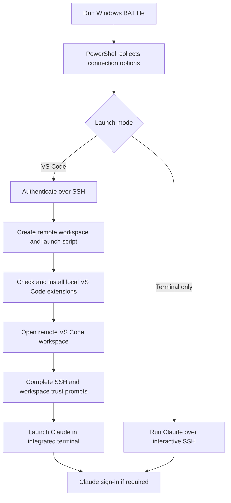

# Claude Code VS Code Remote Launcher

A Windows batch launcher that connects to a Linux server over SSH, opens a remote Visual Studio Code workspace, and attempts to start Claude Code automatically in the integrated terminal.

The goal is to reduce repeated manual setup when working with Claude Code on a remote development server. This is an independent community project, not an official Anthropic or Microsoft product.

## Features

- Interactive server IP/hostname, username, and remote directory prompts.
- Native OpenSSH authentication; the launcher does not collect, save, or copy the SSH password.
- VS Code Remote - SSH extension detection and installation when missing.
- Automatic Claude Code terminal launch through a bundled local VS Code extension.
- Model selection: Sonnet, Opus, Haiku, default, or a custom model identifier.
- Optional continuation of the last Claude conversation in the selected directory (`--continue`).
- Claude account sign-in guidance and a standalone SSH terminal mode.
- A manual VS Code task as a fallback if the automatic terminal does not start.

## Requirements

| Local Windows computer | Remote Linux server |
| --- | --- |
| Windows PowerShell (`powershell.exe`) | Accessible SSH server and an authorized account |
| Windows OpenSSH Client (`ssh.exe`) | Bash and `base64` |
| VS Code 1.80 or newer for VS Code mode | Claude Code CLI installed and available on PATH |
| VS Code CLI (`code` or `code.cmd`) | Permission to access the selected folder and write to the user's home directory |
| Network access to the remote host | Network access required by Claude Code and VS Code Remote - SSH |

A valid Claude account or supported authentication configuration is required to use Claude Code. Model access depends on that account and the server configuration. The launcher does not install Claude Code itself.

Official setup resources: [VS Code Remote - SSH](https://code.visualstudio.com/docs/remote/ssh) and [Claude Code documentation](https://code.claude.com/docs/en/overview).

## Getting started

1. Download `claude-vscode-launcher.bat` from this repository, or clone the repository and open its folder.
2. Review the script and bundled extension source before executing them.
3. Double-click the BAT file, or run it from a Windows Command Prompt:

   ```bat
   claude-vscode-launcher.bat
   ```

4. Enter your server IP address or hostname and Linux username.
5. Select mode `1` to open VS Code, or mode `2` to run Claude directly in the current terminal.
6. Enter an absolute remote folder path, or press Enter to use your home directory.
7. Choose a Claude model and whether to continue your previous conversation.
8. Complete the SSH authentication prompts. If using password authentication, enter the password when OpenSSH requests it. Verify the server fingerprint with your administrator before accepting a new host key.
9. In VS Code mode, complete any additional SSH prompts. Trust the workspace only if you trust the remote server and selected folder.
10. The launcher extension attempts to open the **Claude Code** integrated terminal. Complete Claude sign-in if requested.

### Example session

```text
Server IP or hostname: dev.example.com
Server username: developer
Choose [1/2]: 1
Remote folder (absolute Linux path; Enter = home): /home/developer/project
Model [1-5, Enter = 4]: 1
Continue last Claude conversation in this folder? [y/N]: N
```

These are example values only. Use your own authorized server and account. No default server address is included in the public launcher.

### Model options

| Option | Model | CLI argument |
| --- | --- | --- |
| 1 | Sonnet | `--model sonnet` |
| 2 | Opus | `--model opus` |
| 3 | Haiku | `--model haiku` |
| 4 | Default | None |
| 5 | Custom | `--model <model-name>` |

Select `y` at the continuation prompt to add `--continue`.

## Authentication

There are two separate authentication steps:

**SSH authentication:** OpenSSH or VS Code Remote - SSH requests the server credentials. Passwords are entered into the native authentication prompt, not into a launcher-managed password field. VS Code may request the password again because it establishes its own connection. SSH keys may also be used if configured on the machine and server.

**Claude authentication:** When Claude Code starts, follow its interactive sign-in instructions. If a login URL is displayed, open it in a local browser. The authorized Claude account owner must complete the approval and follow any code-entry prompt. If appropriate, run `/login` inside Claude Code to sign in or switch accounts. The launcher does not bypass account authorization or manage Claude tokens.

## How it works



The BAT file contains an embedded PowerShell script. In VS Code mode, the script creates a uniquely named `.code-workspace` file and a companion `.sh` file under `~/.cache/claude-vscode-launcher/` on the remote host. It does not replace the project's existing `.vscode` configuration.

The launcher checks for Microsoft's Remote - SSH extension (`ms-vscode-remote.remote-ssh`) and a bundled local extension (`local-archimedes.archimedes-claude-launcher`). The bundled extension runs in the local VS Code UI extension host and checks that the workspace is a trusted, matching SSH workspace before creating an integrated Bash terminal and invoking the generated remote shell script. The official Claude Code extension is recommended in the generated workspace but is not automatically installed by the launcher.

The local extension is embedded in the BAT as a Base64-encoded VSIX package. Its readable JavaScript and manifest are included in `extension/` for inspection. The BAT installs the bundled package if the extension is not already present; editing the readable files alone does not change the embedded package.

## Troubleshooting

| Problem | What to do |
| --- | --- |
| `ssh.exe` not found | Install OpenSSH Client through Windows Optional Features. |
| VS Code CLI not found | Install VS Code and enable Add to PATH, then reopen the terminal. |
| SSH connection fails | Check the address, username, credentials, VPN/network access, and server SSH service. |
| SSH password prompt is not visible | Enable `remote.SSH.showLoginTerminal` in VS Code settings. |
| VS Code opens but Claude does not | Trust the workspace if appropriate; open the Command Palette (`Ctrl+Shift+P`) and run `Archimedes: Open Claude Terminal`. |
| Launcher command does not work | Run `Tasks: Run Task` > `Launch Claude Code` from the Command Palette. |
| Claude CLI not found | Ask the server administrator to install Claude Code or correct its PATH. |
| Claude needs authentication | Follow its sign-in instructions or use `/login` as appropriate. |
| Selected folder does not exist | Enter an existing absolute Linux path. |

As a final fallback, open a new terminal in the connected remote VS Code window and run `claude` (or `claude --model sonnet`, for example). The launcher also has standalone terminal mode if VS Code integration is unavailable.

## Security and privacy

- Only connect to servers you are authorized to access. Verify new SSH host keys before accepting them.
- The script uses native SSH authentication rather than storing a plaintext password or placing it on the clipboard.
- The launcher does not contain a default private server IP, API key, or account token in this public copy.
- The launcher installs an embedded local VS Code extension that executes a generated script on the remote server. Inspect the included source and package before trusting or running it.
- Claude Code may independently retain authentication state and conversation data according to its configuration. The launcher does not control that storage.
- Do not commit private SSH configurations, credentials, tokens, internal hostnames, generated workspace files, or company-specific information to a public repository.

## Project structure

```text
.
├── README.md
├── claude-vscode-launcher.bat
├── .gitignore
└── extension/
    ├── package.json
    └── extension.js
```

## Cleanup

To remove the local launcher extension, uninstall **Archimedes Claude Terminal Launcher** from the local VS Code Extensions view, or run:

```bat
code --uninstall-extension local-archimedes.archimedes-claude-launcher
```

Generated remote `.code-workspace` and `.sh` files remain under `~/.cache/claude-vscode-launcher/`. You may remove the specific generated files when they are no longer needed. Close their VS Code windows first. This does not remove Claude Code or its credentials.

## Development and contributions

Issues and pull requests are welcome, subject to the repository's eventual license and contribution terms. Useful improvements include support for additional SSH configurations, better launch diagnostics, automated Windows/Linux integration tests, and a reproducible VSIX packaging workflow.

When reporting a bug, include the Windows and VS Code versions, remote Linux distribution, launch mode, and a redacted error message. Never include passwords, login codes, tokens, or private server details.

## Project status and license

This is an initial implementation. The launcher and embedded extension source have been inspected, but live Windows-to-Linux SSH, VS Code startup, and Claude authentication have not been verified in an end-to-end test. Automatic launch may depend on VS Code extension activation and workspace trust; use the documented fallback if necessary.

No license has been selected in this package. Before distributing it as open-source software, confirm you have the right to publish the code and add a suitable `LICENSE` file (for example, MIT if you want a permissive license). Third-party products and extensions retain their respective licenses and terms.
